# Duka Digital

A mobile-first storefront for Kenyan small businesses: browse a catalog, pick options, review a cart, get clear **simulated** Lipa na M-Pesa instructions, then send a complete order summary to the merchant on **WhatsApp**.

The demo merchant is **Nyota Atelier**, a fictional contemporary fashion boutique in Nairobi. All products, prices, Till and Paybill numbers, phone numbers and addresses are **demonstration data**.

> **Payments are simulated.** Nothing on this site verifies, takes or records a payment. The UI never asks for an M-Pesa PIN and never says a payment was verified. The shop confirms payment on WhatsApp.

## Screenshots

Captured from the running app with headless Chromium (`screenshots/`).

| Mobile (390px) | | |
| --- | --- | --- |
| 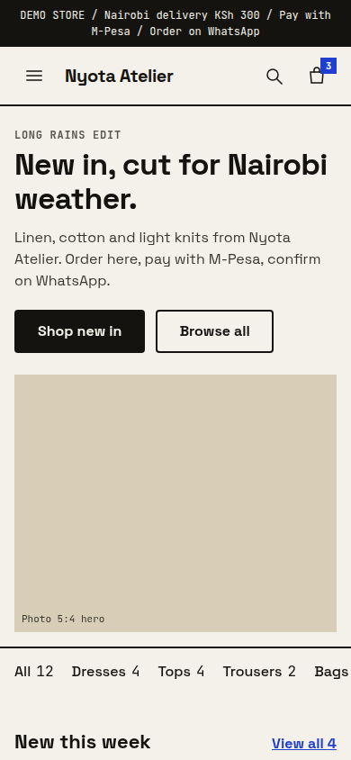 | 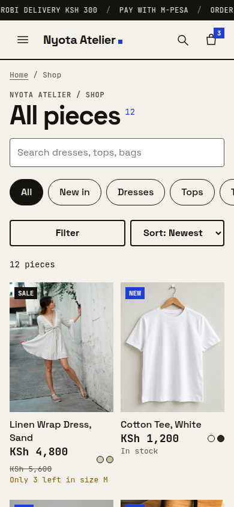 | 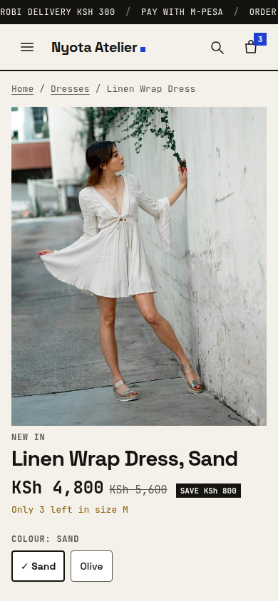 |
| Home | Catalog | Product |
| 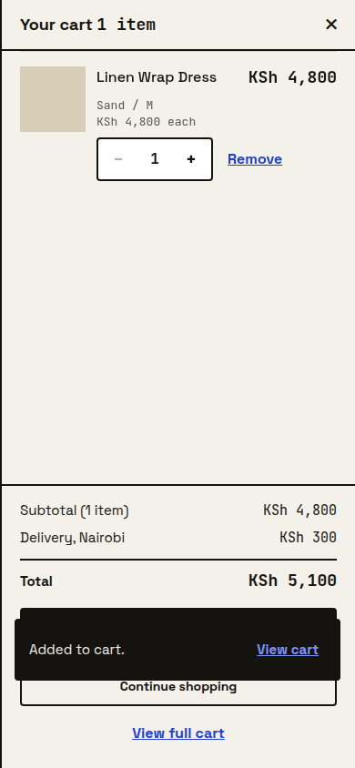 | 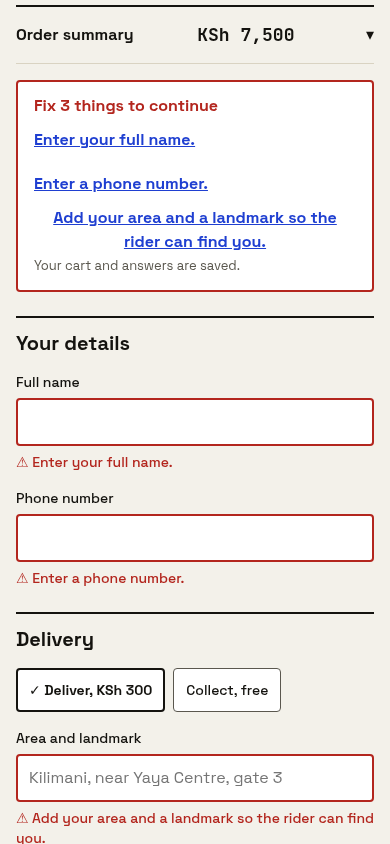 | 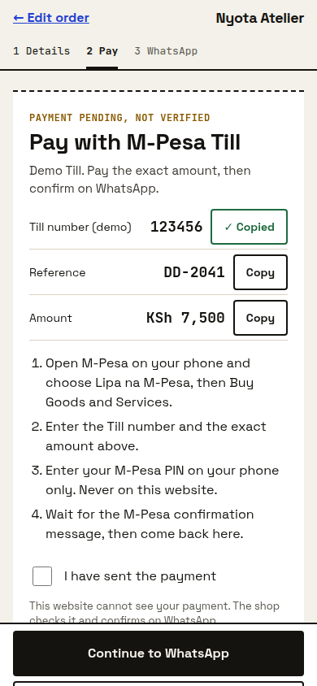 |
| Cart drawer | Checkout validation | M-Pesa instructions |
| 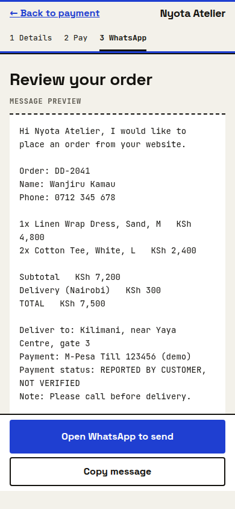 | | |
| WhatsApp review | | |

| Tablet (768px) | Desktop (1280px) |
| --- | --- |
| 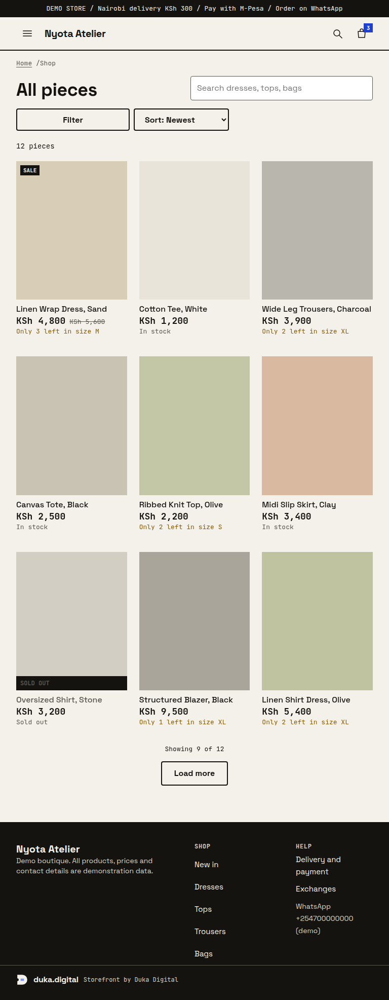 | 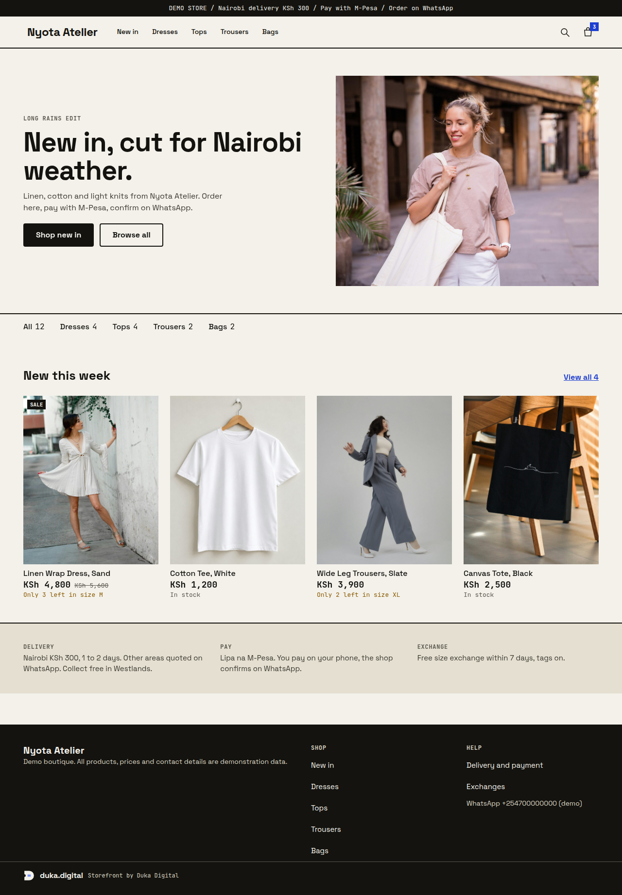 |
| 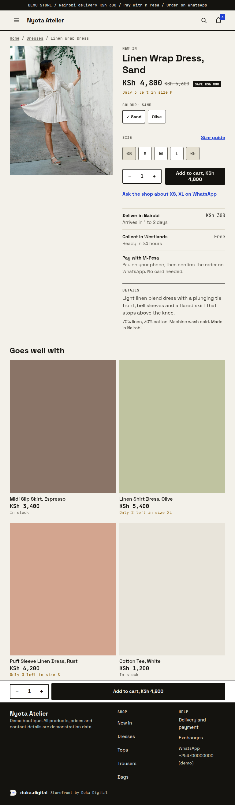 | 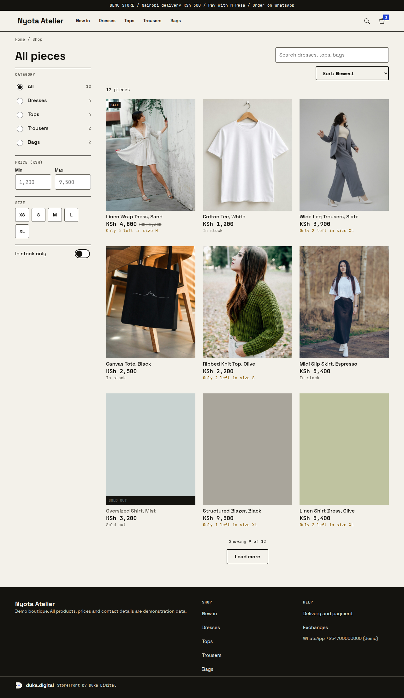 |

More desktop screens: [product](screenshots/d-product.png), [cart](screenshots/d-cart.png), [checkout](screenshots/d-checkout.png), [payment](screenshots/d-payment.png), [WhatsApp](screenshots/d-whatsapp.png).

## Features

- **Discovery:** home, catalog with search, category, price, size and in-stock filters, four sort orders, "Load more" paging, and URL-backed filters you can share.
- **Mobile filter sheet:** a bottom sheet on phones and tablets, a sticky sidebar from 1024px.
- **Product pages:** swipeable gallery on phones, thumbnails on desktop, colour and size chips, sold-out sizes struck through and labelled, stock messages, quantity stepper, a sticky add-to-cart bar on phones, delivery and payment information, related products.
- **Cart:** drawer plus full page, quantity limits from stock, remove with Undo, delivery or collection choice, totals that recalculate instantly, persisted on the device.
- **Checkout:** no account, inline and summary validation, Kenyan phone formats (07xx, 01xx, +254), entries preserved on error.
- **M-Pesa simulation:** Till or Paybill (configurable), exact amount, order reference, copy buttons with a manual fallback, numbered steps, "I have sent the payment" only changes the message to "reported by customer, not verified".
- **WhatsApp handoff:** previewable message with items, variants, line prices, subtotal, delivery, total, address or collection point, payment status and note, built into a URL-encoded `wa.me` link. After the click it asks "Did WhatsApp open?" and never claims the order was sent.
- **States:** skeleton loaders, empty cart, no results, 404, unavailable items, error toasts, saved-checkout "Welcome back" banner.
- **Motion:** subtle page, drawer, sheet, toast and button transitions. Everything is disabled under `prefers-reduced-motion`.
- **Accessibility:** skip link, focus moved to `<main>` on navigation, focus-trapped dialogs that restore focus, labelled controls, `aria-live` feedback, visible focus rings, 44px touch targets.

## Tech stack

- React 18 and Vite 5
- React Router 6 (including `/product/:slug`)
- Context API with `useReducer` for the cart and checkout state
- CSS Modules for component-scoped styling plus a small design-token stylesheet
- `@fontsource` packages for self-hosted Space Grotesk and JetBrains Mono (no external font requests)

No UI kit, state library or animation library.

## Getting started

Requires Node 18 or newer.

```bash
npm install
npm run dev        # http://localhost:5173
npm run build      # production build in dist/
npm run preview    # serve the build at http://localhost:4173
```

### Configuration

Copy `.env.example` to `.env` to change the demo values. They are read at build time and must **never** contain real payment credentials.

| Variable | Default | Meaning |
| --- | --- | --- |
| `VITE_PAYMENT_MODE` | `till` | `till` or `paybill` |
| `VITE_TILL_NUMBER` | `123456` | Demo Till number |
| `VITE_PAYBILL_NUMBER` | `400200` | Demo Paybill business number (account number is the order reference) |
| `VITE_WHATSAPP_NUMBER` | `254700000000` | Demo shop number, international format without `+` |

Delivery fee, collection point and limits live in `src/config.js`.

## Project structure

```
src/
  components/   reusable UI, each with its own CSS Module
  context/      CartContext, CheckoutContext, UIContext (reducers and providers)
  data/         demo catalog and helpers
  hooks/        useOrder, useSimulatedLoad, useMediaQuery, useKeyboardOpen, useRouteFocus
  pages/        Home, Catalog, Product, Cart, Checkout, Payment, Review, Help, NotFound
  styles/       tokens.css, global.css
  utils/        format (KSh), phone, order totals, validation, WhatsApp message, storage
public/placeholder.svg   transparent placeholder used for every image src
```

Money formatting, totals and the WhatsApp message each come from one function, so the cart, checkout, M-Pesa panel and message cannot disagree.

### Images

Every image is a plain `` with `src="/placeholder.svg"`, a fixed 4:5 box and a tinted background. Replace the `images` arrays in `src/data/products.js` with real 4:5 photographs to go live. No external images are used.

### Using real photos (for example from Unsplash)

1. Download photos and save them as `public/images/hero.jpg` and `public/images/products/<slug>-1.jpg` (see `public/images/README.md` for the slugs).
2. Set `VITE_USE_PHOTOS=true` in `.env`. Set `VITE_PHOTOS_PER_PRODUCT` to how many files each product has (default 1).
3. Restart `npm run dev`. A missing file falls back to the placeholder, so you can add photos gradually.

### Replacing the simulation with real payments

`PaymentPanel` only displays instructions. To add a real integration later, supply a provider that returns the instructions (or starts an STK push) for an order and reports a verified status from a server. Keep the "not verified" wording until a server confirms it.

## Testing

Verified against a production build with headless Chromium:

- Full journey on a 390px phone: filter, search, sort, product options, add to cart, drawer, quantity changes, remove and undo, checkout validation, M-Pesa panel, copy to clipboard, resume banner, WhatsApp link (the decoded `wa.me` text equals the previewed message). 34 scripted checks passed.
- Totals checked by hand: KSh 4,800 + 2 x KSh 1,200 + KSh 300 delivery = KSh 7,500 on every screen.
- No horizontal overflow and no touch target under 44px on every route at 320, 360, 390, 768, 1024, 1280 and 1440px, including the cart drawer, menu and search overlay.
- Keyboard: dialogs trap focus and return it, Escape closes them. Reduced-motion run had no errors. No console errors in any run.

Not tested: real phones, Safari and Firefox, screen readers (VoiceOver, TalkBack), real WhatsApp or M-Pesa. Treat those as open before launch. There is no automated test suite in the repository yet.

## What I learned

- **State shape matters more than libraries.** A single `items` array of `{ slug, colour, size, qty }` with prices joined from the catalog at render time removed whole classes of bugs, such as stale prices in storage.
- **One source of truth for money.** Routing every amount through `formatKSh` and `calcTotals` made the cart, payment panel and WhatsApp message agree by construction.
- **Design for the app switch.** Paying means leaving the site for the M-Pesa menu. Persisting the cart and checkout with an expiry, plus a resume banner, turns that from a risk into a normal step.
- **Honest wording is a feature.** "Pending, not verified" and "Your order is not sent yet" cost nothing and prevent the worst misunderstanding in a simulated flow.
- **Accessible dialogs are work.** Focus trapping, focus return, scroll locking and animated exit needed one shared `Overlay` so the drawer, menu, search and filter sheet behave the same.
- **Measure, do not guess.** Scripted overflow and tap-target sweeps found real problems (cramped cart rows, small links) that were invisible by eye.

## Limitations

Demo data only, simulated latency for skeletons, stock is per size and shared across colours, the order reference is a per-device counter (a real backend must issue unique references), and the cart lives in `localStorage` for 7 days.

## License

MIT for the code. Demo product names, prices and contact details are fictional.
